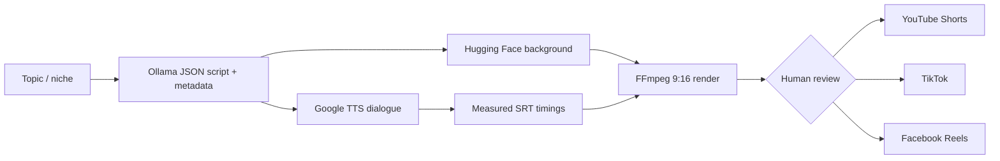

# Vertical Skit Automation

A complete Node.js pipeline for generating an original skit with local Ollama, creating a background through Hugging Face, synthesizing speech, burning timed subtitles into a 1080x1920 MP4, and optionally publishing it to YouTube Shorts, TikTok, and Facebook Reels.

Publishing is deliberately private/draft and dry-run by default. That gives you a chance to catch a bad generation before it reaches three public accounts.



## What is included

- Strict JSON-schema output from Ollama, followed by Zod validation.
- Episode-specific titles, descriptions, captions, and 3-8 hashtags.
- Hugging Face `InferenceClient.textToImage()` integration.
- Free `google-tts-api` speech, per-line audio measurement, natural pauses, and automatic SRT creation.
- Bundled FFmpeg/FFprobe binaries, so a system FFmpeg install is not required.
- A `fluent-ffmpeg` complex filter that cover-scales and crops the image, adds subtle movement, burns subtitles, encodes H.264/AAC, and stops with the audio at a configurable 60 seconds.
- Modular YouTube, TikTok, and Facebook publishers, upload retry safety, and AI-content disclosure fields.
- Cron scheduling with overlap protection.
- Human-review, dry-run, private/draft, and per-platform controls.

## Quick start

Prerequisites: Node.js 20+, [Ollama](https://ollama.com/download), and a Hugging Face account.

```powershell
npm install
ollama pull qwen2.5:7b
Copy-Item .env.example .env
```

Put your Hugging Face token in `.env`, leave `DRY_RUN=true`, then generate a video:

```powershell
npm run generate -- --topic "a developer who deploys on Friday"
```

The job folder under `output/` contains:

- `content.json` — dialogue, scene prompt, title, descriptions, and hashtags
- `background.png`
- `dialogue.mp3` and `audio-timeline.json`
- `subtitles.srt`
- `video.mp4`
- `manifest.json`

Test and check the project with:

```powershell
npm test
npm run check
```

## Safe publishing workflow

First configure the relevant OAuth credentials in `.env` using [docs/PLATFORM_SETUP.md](docs/PLATFORM_SETUP.md). Generate and watch the entire video. Then set `DRY_RUN=false` and run:

```powershell
npm run publish -- --job ".\output\YOUR-JOB-DIRECTORY" --approve --platforms youtube,tiktok,facebook
```

The `--approve` flag is required while `REQUIRE_APPROVAL=true`. You can publish to one platform first, for example `--platforms youtube`. Results are stored in `publish-results.json`; a retry skips platforms already marked successful, preventing duplicate posts after a partial failure.

To generate and publish in one command after testing:

```powershell
npm run generate -- --topic "code review misunderstandings" --publish --approve
```

Recommended testing states are `YOUTUBE_PRIVACY_STATUS=private`, `TIKTOK_PRIVACY_LEVEL=SELF_ONLY`, and `FACEBOOK_VIDEO_STATE=DRAFT`. Public API posting is also restricted until YouTube/TikTok/Meta approve or audit the developer app.

## Scheduling

Set `SCHEDULE_CRON`, `SCHEDULE_TIMEZONE`, and pipe-separated `SCHEDULE_TOPICS` in `.env`, then keep this process running:

```powershell
npm run schedule
```

`PUBLISH_ON_SCHEDULE=false` renders review-ready jobs only. Fully unattended publication requires `PUBLISH_ON_SCHEDULE=true`, `DRY_RUN=false`, and `REQUIRE_APPROVAL=false`. Do that only after a long private test period; a scheduler cannot judge whether a generated joke, image, or claim is appropriate.

On a zero-budget Windows machine, Task Scheduler can launch `npm run schedule` at login. On Linux, use systemd or cron. A continuously running local computer still consumes electricity and must remain connected.

## Facebook upload endpoints implemented

The Page Reels publisher performs the exact three-phase flow:

1. Create the video container: `POST https://graph.facebook.com/{version}/{page-id}/video_reels?upload_phase=start&access_token={page-access-token}`
2. Upload local binary data: `POST https://rupload.facebook.com/video-upload/{version}/{video-id}` with `Authorization: OAuth {page-access-token}`, `offset: 0`, `file_size`, and the raw MP4 request body. The implementation prefers the `upload_url` returned by phase 1.
3. Finish/publish: `POST https://graph.facebook.com/{version}/{page-id}/video_reels?upload_phase=finish&video_id={video-id}&video_state={DRAFT|SCHEDULED|PUBLISHED}&...`

The version is configurable with `FACEBOOK_GRAPH_VERSION`; update it before Meta retires the configured version.

## Zero-cost reality check

The code and local Ollama execution do not have license fees. The bundled TTS route is free but unofficial and can change or rate-limit without notice. Hugging Face gives limited monthly inference credits; it is not unlimited free production capacity. Platform developer APIs usually have no per-upload fee, but require accounts, OAuth setup, audits, and compliance.

Most importantly, automation is not a monetization guarantee. A static-image, templated, mass-produced channel can be rejected as repetitive or unoriginal. Use the tool as a production assistant: maintain recurring characters, materially different storylines, a clear creative point of view, and manually reject weak episodes. Never buy views or followers. The practical next quality upgrade is generating several original scene images per episode instead of relying on one background.

## Module map

- `src/generator.js` — Ollama structured writing
- `src/image-generator.js` — Hugging Face image generation
- `src/audio-generator.js` — TTS, duration probing, and audio assembly
- `src/subtitles.js` — SRT timing and line wrapping
- `src/editor.js` — FFmpeg complex filter and output validation
- `src/publisher.js` — all three platform uploaders
- `src/pipeline.js` — job orchestration and review gate
- `src/job-service.js` — persistent browser/API job lifecycle
- `src/server.js` — REST API, media delivery, and production frontend hosting
- `src/scheduler.js` — recurring runs
- `src/cli.js` — commands

## Known operational limits

- `google-tts-api` calls an undocumented service. Replace `generateDialogueAudio()` with a locally hosted TTS engine if reliability becomes important.
- Hugging Face models/providers can change availability. Both model and provider are environment settings.
- OAuth access and Page tokens expire or can be revoked. Never commit `.env`.
- TikTok processing is asynchronous. The returned `publish_id` can be checked through `fetchTikTokPublishStatus()`.
- TikTok access tokens are proactively refreshed and retried once on `access_token_invalid`; rotated bundles are stored in the Git-ignored `data/tiktok-tokens.json` file.
- One 60-second asset fits the documented Facebook Page Reel maximum and TikTok Creator Rewards minimum, but platform rules can change. Recheck them before going public.
